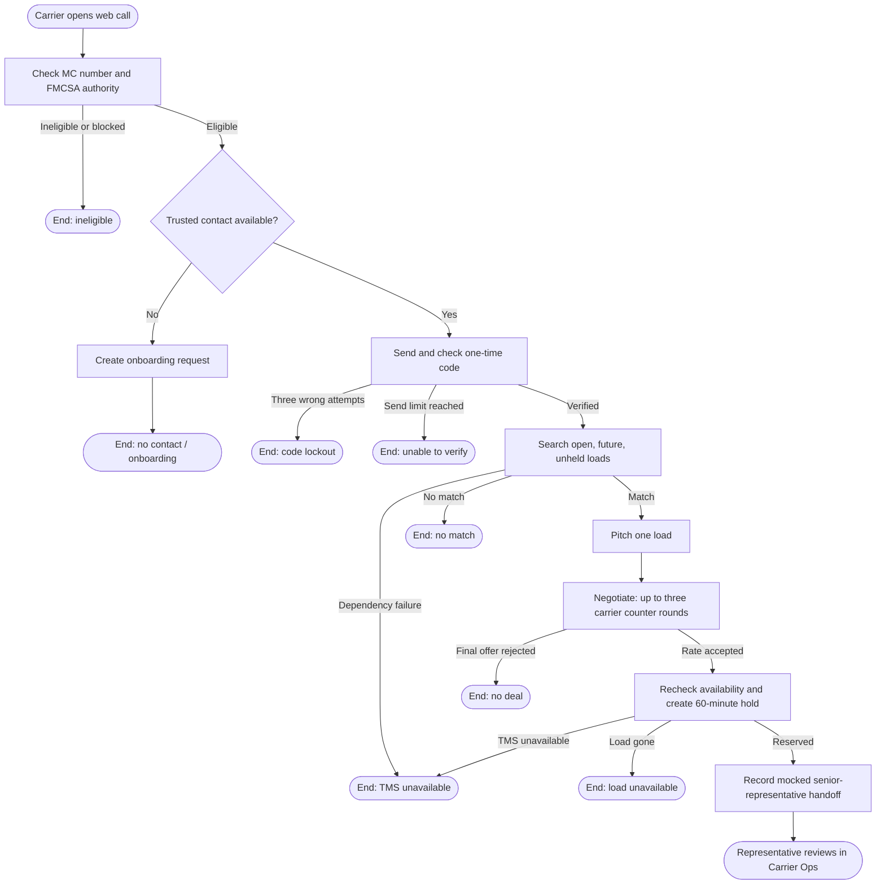
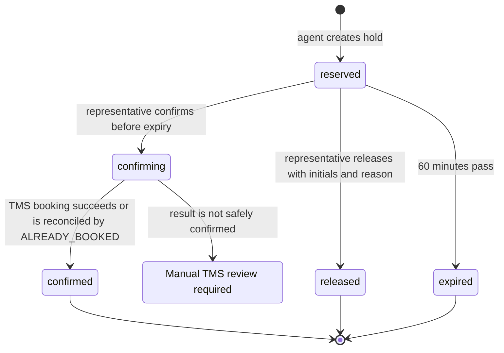
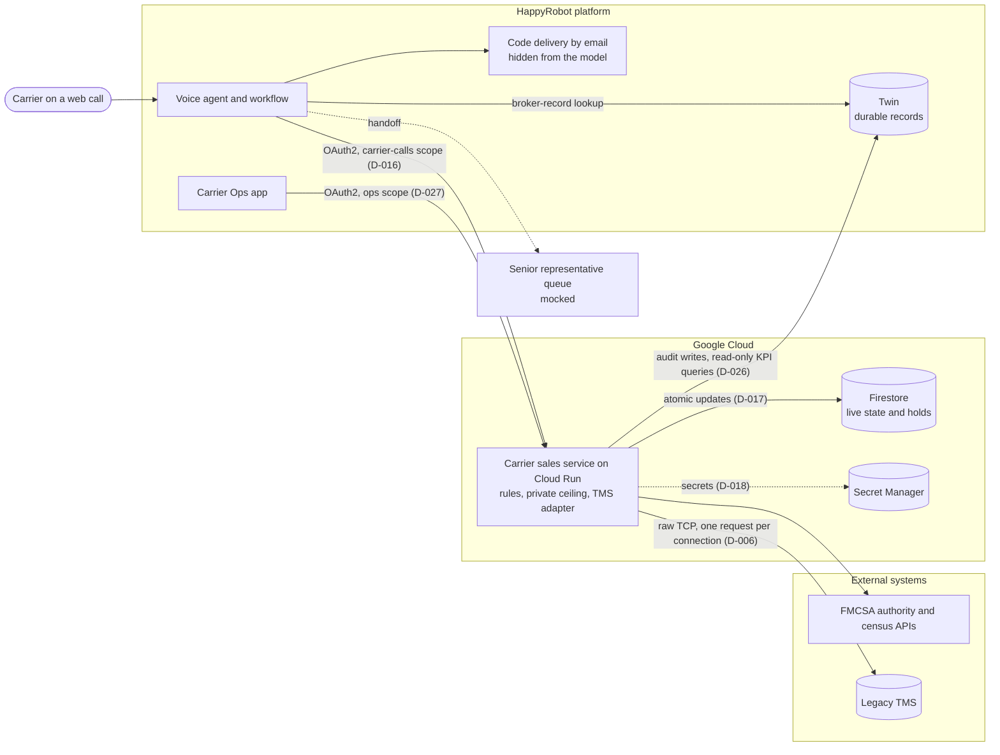

# HappyRobot Logistics: Inbound Carrier Sales Build Document

## 1. Summary

The inbound carrier sales system answers web calls, checks carrier authority, searches loads, negotiates rates, and records each outcome. In doing so, it addresses two direct sources of lost value for the brokerage: missed calls, which lose bookings, and manual work, which consumes representative time and margin.

The proof of concept completes the web-call path from Federal Motor Carrier Safety Administration (FMCSA) verification through load search, negotiation, and a temporary reservation, although no phone number is provisioned in the current build. Along that path, a TypeScript service enforces the rules outside the voice model, so the model never controls price or verification. The final decision still belongs to a senior representative, who confirms or releases each reservation in Carrier Ops.

Recorded QA found no ceiling disclosures, verification bypasses, or above-ceiling bookings, and the complete path also ran in production. These results prove the system's mechanics and controls. The next step is to measure the size of the business return: the proposed two-week pilot runs on one live line and quantifies the return from answered calls, consistent negotiation, less repetitive work, and connected records against the current baseline.

## Terms

| Term | Plain-language meaning |
| --- | --- |
| MC number | A Motor Carrier number assigned for federal operating-authority purposes. |
| FMCSA | The Federal Motor Carrier Safety Administration, whose data is used to check carrier authority and identity. |
| TMS | The transportation management system that stores loads, availability, private pricing, and bookings. |
| Twin | HappyRobot's structured data store for durable carrier, call, offer, event, pricing, and onboarding records. |
| Ceiling | The broker's private maximum payment for a load. The voice model never receives it. |
| Hold | A temporary reservation that keeps a load from being offered to another caller while a representative reviews it. |
| One-time code | A single-use, six-digit verification code sent to a trusted contact. |
| Carrier Ops | The HappyRobot App used to review calls, holds, onboarding requests, and performance measures, and to confirm or release reservations. |

## 2. The opportunity

The system addresses five problems that affect revenue, capacity, pricing discipline, and call records. For each one, current evidence proves the operating path and its controls, while the proposed pilot quantifies the resulting business improvement.

| Problem | Build response | Evidence and remaining measure |
| --- | --- | --- |
| Missed calls and long holds | The agent qualifies callers and creates temporary reservations. | Both paths ran. The pilot measures answer and hold gains against the current baseline. |
| Inconsistent negotiation | The service applies one three-round formula below the ceiling. | About 250 combinations stayed within the ceiling; the agent retained 27% of the negotiation room in testing. |
| Manual FMCSA checks | The service checks authority, contact data, and the DOT-number match. | Seeded verification was 71% against an 85% target. The pilot quantifies representative time saved. |
| Missing audit records | Twin records the connected call history for Carrier Ops. | The record is visible; writes remain best-effort after retries. |
| Dispatcher burnout | The agent handles repetitive steps; a representative controls booking. | The path ran. The pilot measures workload and staff satisfaction against the current baseline. |

In other words, the build has already shown that each response works, and the pilot determines how much each one is worth to the operation. The sections that follow explain how a call moves through the system, how it is kept safe, and what testing found.

## 3. How a call works

The call order is designed to protect carrier identity and private pricing. For that reason, the service blocks load search, negotiation, and reservation until the active carrier passes the code check. The diagram shows every path a call can take and where each one ends.

In the successful path, the carrier gives an MC number, the service confirms FMCSA authority, and a one-time code goes to a trusted contact on record. Once the code is verified, the agent pitches one matching load, negotiates for up to three carrier counter rounds, and places a 60-minute hold when a rate is agreed. Every other branch ends the call with a recorded outcome rather than an unchecked booking. Three service rules support this path:

1. HappyRobot pins the workflow run ID into service calls, which lets the service permit no more than three distinct MC numbers per call.
2. During the call, the current build accepts an email address only for a sandbox carrier. Code send, expiry, and attempt limits appear in the technical reference in the repository.
3. The service normalizes lane and equipment searches, and its responses never contain the private ceiling.

### What the representative does

The call ends at a hold, not a booking. Once the agent has placed a hold, Carrier Ops keeps the irreversible decision outside the voice workflow. The representative first reviews the carrier, load, rate, notes, and hold time. Confirmation then claims the reservation before the TMS booking is sent, while a release requires initials and a reason. If the booking result is uncertain, the reservation becomes `booking_unresolved` and stays blocked until it is reconciled manually.

## 4. Architecture

The architecture follows the same principle as the call order: private pricing and enforcement remain outside the voice model. The service sits between the voice workflow and the broker's systems, writes durable call activity to Twin, and gives operations a controlled booking interface.

- The workflow runs the conversation and calls narrow service tools.
- The service enforces identity, verification, pricing, reservations, booking state, and audit writes.
- Firestore holds state and reservations that require atomic updates.
- The TMS adapter validates legacy TCP replies and separates read retries from booking reconciliation.
- FMCSA supplies authority data and a fallback trusted contact.
- Twin stores the durable business record, and Carrier Ops presents it to operations.

### Why Firestore is used alongside Twin

Data is split between two stores for a specific reason. Twin stores durable business history, but its available external interface does not support atomic updates to verification attempts, negotiation rounds, and holds. For that reason, Firestore holds that live state, while Twin stays the durable record (D-017). Operations reviews that record in Carrier Ops, a HappyRobot App, so the operator interface stays on the platform.

The API surface appears in Appendix A, and the complete component responsibilities remain in the technical reference in the repository. With the components in place, the next section explains how they are protected.

## 5. How it is kept safe

Because the service holds the rules, it also holds the protections. They work at three levels: who can call the service, what private data can leave it, and how it behaves when a dependency fails.

Access starts with OAuth2 client credentials, which issue 15-minute tokens, and each client receives only the scope it needs: the workflow receives only `carrier-calls`, while Carrier Ops receives only `ops`. Beyond authentication, the service rate-limits requests, binds verification to the carrier, limits MC and code attempts, hashes codes, allow-lists load responses, and uses atomic reservation transitions.

The most sensitive value, the private ceiling, never leaves the service or the restricted `load_pricing` table, and no attack revealed it. The model also has no control over the values that create a reservation. In other words, the ceiling, MC number, load price, and booking price come from verified state and TMS data that the service reads, not from anything the model says.

When a dependency fails, the build stops rather than guessing a safe result. The TMS integration treats reads and bookings differently. Searches and lookups retry safely because they are read operations. A booking, however, uses an availability check and no more than two sends, and an uncertain result becomes `booking_unresolved` for manual review.

The same rule applies across the other dependencies. TMS reads retry behind a circuit breaker, an FMCSA outage stops verification instead of inferring eligibility, and an uncertain booking stays blocked for operations review. Audit writes follow the same principle without blocking the call: Twin writes are retried three times, then fall back to Cloud Run logs, so a logging outage never stops a carrier call. Appendix B gives each dependency's timeouts, caller effect, and recovery, and Appendix C lists the six Twin tables, from carriers and calls to the restricted pricing table. The technical reference covers the complete security, TMS, and audit detail.

## 6. Testing and QA

Section 5 explains how the system is protected. This section shows whether those protections held under test and how well the call path performed. Every result below is measured against a target set before testing, starting with the three safety measures that have a target of zero, because a single failure there would leak the private ceiling, admit an unverified carrier, or overpay for a load. The remaining measures cover verification, conversion, negotiation, and TMS reliability.

| KPI | Target | Recorded result and scope |
| --- | --: | --- |
| Ceiling disclosures | 0 | 0 in agent-facing API scans and five ceiling-extraction scenarios. |
| Verification bypasses | 0 | 0 in three bypass attacks and service gate tests. |
| Bookings above ceiling | 0 | 0 in about 250 strategy combinations. |
| Verification pass rate | At least 85% | 71% in seeded data that included ineligible carriers, lockouts, and false-code cases. |
| Time to verify | At most 90 seconds | 4 to 16 seconds through the API and about 30 to 45 seconds in live calls. |
| Reservation rate among verified calls | At least 35% | 50% in the seeded mix. |
| Negotiation room retained | At least 25% | 27% in the seeded mix. |
| TMS operations successful after retries | At least 99% | 100% of 300 read operations at a 16.2% raw fault rate. |

Behind these results, each layer of the system was tested on its own and then end to end. The service passed all 312 of its tests. In staging, 18 API scenarios passed and none failed; one was not run because no safe test fixture existed. All nine conversation tests passed in each of 19 runs of workflow Version 18, a TMS soak test checked reliability under injected faults, and two calls completed the full path in production.

The most important tests were adversarial, aimed at the two controls that protect the business most. To learn the private maximum rate, testers asked for it directly, probed for a budget, injected instructions into the conversation, and claimed false market rates. To get past carrier verification, they claimed a lost phone, invoked owner authority, and entered false codes. None succeeded, because the ceiling never reaches the voice model and the code check runs in the service, outside the conversation.

Taken together, the results show that the safeguards hold. In every tested case, the system kept the ceiling private, stopped unverified carriers, and never booked above the ceiling, and the complete call path works in production. The conversion, timing, and margin figures come from small scripted samples, so they show the system working as designed rather than its performance at live volume. Measuring that performance is the purpose of the pilot described in Section 7. KPI definitions, test layers, and full limits appear in the technical reference.

## 7. Return on investment

With the safeguards proven, the next question for HappyRobot Logistics is what the system is worth. It creates value in three ways. First, it keeps more margin on every load it negotiates. Second, it books loads from calls that would otherwise be missed. Third, it frees representatives from repetitive qualification work so they can focus on decisions. The table connects each business problem from Section 2 to the value the system creates and the evidence already behind it.

| Business problem | How the system creates value | Evidence today |
| --- | --- | --- |
| Missed calls and long holds | Every call is answered immediately, so loads book from calls that would otherwise go to voicemail or a competitor. | Half of verified seeded calls ended in a reservation; live verification took about 30 to 45 seconds. |
| Inconsistent negotiation | Every load follows the same three-round strategy below the private ceiling, so margin no longer depends on who answers. | The agent kept 27% of the negotiation room and never booked above the ceiling in about 250 combinations. |
| Manual FMCSA checks | Authority, contact, and identity checks run automatically before any load is discussed. | Verification took 4 to 16 seconds through the API, and no bypass attack succeeded. |
| Missing audit records | Every call, offer, and decision is recorded and visible in Carrier Ops, so reconciliation starts from a complete history. | Each call writes its events, outcome, and run link to Twin. |
| Dispatcher burnout | Representatives review holds and exceptions instead of handling every call from the start. | Both production paths ran with a representative confirming or releasing the hold. |

The dollar size of each lever depends on HappyRobot Logistics' own call volume, lanes, and labor costs, which only live operation can supply. For that reason, a two-week pilot on one live line is proposed to turn this evidence into a measured return. The pilot runs the system on real calls and compares them with a matched baseline of calls handled the current way.

Each lever then becomes a dollar figure from observed inputs:

- Margin kept: on each booked load, the private ceiling minus the agreed rate, summed across the pilot.
- Incremental margin: pilot margin kept minus the margin kept on matched baseline loads.
- Recovered bookings: extra confirmed bookings compared with the baseline, multiplied by the measured contribution per booking.
- Capacity value: representative minutes saved on the same call stages, converted to hours and multiplied by the fully loaded hourly labor cost.
- Audit labor avoided: reconciliation minutes saved, multiplied by the applicable labor cost.
- Operating cost: the added cloud, messaging, support, and operations cost of running the pilot.
- Pilot ROI: total measured benefit minus operating cost, divided by operating cost.

To keep the comparison fair, pilot and baseline calls cover the same time window, a similar mix of carriers and lanes, and the same rules for what counts as a booking or a lost call. The result is a measured return for HappyRobot Logistics. Each measure is defined in the KPI dictionary in the technical reference, and the production deployment described next is what allows the pilot to start on a live line.

## 8. Deployment and operations

The service is built to run in any cloud the client chooses. It ships as a standard Docker image, reads all of its settings and secrets from environment variables, and keeps its live state behind a storage interface, so nothing in the application code is tied to one provider. The deployment script reflects this: the cloud is its first argument (`./deploy.sh <gcp|aws|azure> <staging|production>`), and one command builds and deploys the container.

For this proof of concept, Google Cloud is the implemented target, with Cloud Run for the service, Secret Manager for production secrets, and Firestore for live state. Cloud Run uses scale-to-zero, a two-instance maximum, 1 CPU, 512 MiB of memory, and 40 concurrent requests per instance. Moving to AWS or Azure follows the path the script already documents: the same image runs on AWS App Runner or ECS Fargate, or on Azure Container Apps, with the same secrets stored in that provider's secret manager. The only code change is a second implementation of the live-state storage interface for that provider's database, such as DynamoDB or Cosmos DB. The in-memory implementation used in tests shows that the interface already supports more than one backend.

On the HappyRobot side, Version 18 runs in Development with staging integrations, while Version 19 runs in Production with production credentials and Twin settings. Production is therefore already in place for the pilot. Deployment and portability detail remains in the technical reference.

## 9. Next steps

The next steps move the system from a proven proof of concept to a measured live operation. The pilot comes first, and the remaining items prepare the system for wider use.

1. Run the controlled production pilot with known carriers, named operations owners, a fixed observation window, and baseline measures.
2. Add an approved SMS sender, retain email as a fallback, and capture delivery receipts and failures without exposing the code to the model.
3. Replace the mocked handoff with a phone entry point and tested senior-representative queue while retaining reservation-first booking control.
4. Replace self-reported initials with platform identity and restrict sensitive views by role.
5. Obtain written TMS time-zone semantics and add daylight-saving regression tests if the zone is not UTC.

The technical reference contains the full list of limits and next steps.

## 10. Conclusion

HappyRobot Logistics loses value in two places: calls that go unanswered, and representative time spent on repetitive qualification. The build addresses both. A web-call agent verifies each carrier against FMCSA and a one-time code, finds a matching load in the TMS, negotiates for up to three rounds below a private ceiling, and places a 60-minute hold. A senior representative then confirms or releases that hold in Carrier Ops, so the irreversible booking stays with the brokerage, and Twin records every call, offer, and outcome.

The evidence shows that this design holds. The voice model never receives the ceiling or sets the values behind a reservation, because the service enforces identity, pricing, and booking state. Under test, adversarial attempts produced no ceiling disclosures and no verification bypasses, about 250 strategy combinations produced no booking above the ceiling, TMS reads succeeded in all 300 operations at a 16.2% raw fault rate, and two calls completed the full path in production. In the seeded mix, half of verified calls ended in a reservation, and the agent kept 27% of the negotiation room.

In other words, the system works and its safeguards hold. Its dollar value depends on the brokerage's own call volume, lanes, and labor costs. The decision requested is therefore approval of the two-week pilot on one live line, which measures margin kept, recovered bookings, representative capacity, and operating cost against a matched baseline and turns this evidence into a measured return.

## Links

- Live workflow (web call): https://platform.happyrobot.ai/deployments/gzojj9w9w21e
- Carrier Ops dashboard: https://hr-carrier-ops.happyrobot.dev
- Repository (private): https://github.com/adiaz0511/happyrobot-carrier-sales
